# World Radio


Internet radio for Minecraft 26.2 (Fabric) that works like real radio. A **Radio Transmitter** sends an MP3 internet
stream as a signal, and a **Radio** or a **Portable Radio** inside its range plays it. **Radio Channels** add more
stations to the same mast, **Radio Amplifiers** carry the signals further and **Speakers** make a radio heard further.
Where several signals arrive, every radio picks its own station. Stations come from the free
[Radio-Browser](https://www.radio-browser.info) catalogue, from a search by name or genre, or from any stream address
you paste, and your own list of favorites comes with you into every world. Everything is in its own creative tab,
*World Radio*.

> *"This is World Radio. Stay tuned."*

> **Coming from 1.x?** The old Radio block is now the Radio Transmitter: it keeps its station, antenna and range, but
> it no longer makes a sound by itself. Place a Radio near your builds or carry a Portable Radio to hear it again.

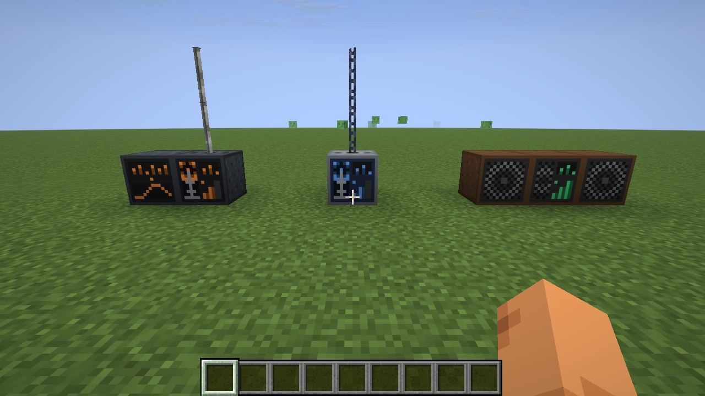

## Download

Get `worldradio-<version>.jar` from [CurseForge](https://www.curseforge.com/minecraft/mc-mods/world-radio) or the
[GitHub releases](../../releases) and put it into `mods/` on the client and the server, next to Fabric API.
Requires Minecraft 26.2, Fabric Loader 0.19.3+ and Java 25. The server never streams anything: it only stores
which station a transmitter sends and what each radio is set to, every player's game fetches the stream itself.

## The guide book

The **World Radio Guide** is a book with a chapter for every block and for range and antennas, finding stations and
listening, with the recipes and build pictures, in English and German. Craft it from a book and a copper ingot
(shapeless, in the Misc tab of the recipe book), or take it from the creative tab. Right-click opens it, E or Escape
closes it; the blocks' tabs are on the left, the topics' on the right.

This page follows the book chapter by chapter and adds the details that do not fit on its pages.


<!-- listing:skip -->
| Chapter | |
|---|---|
| [Getting Started](#getting-started) | three steps to the first station |
| [Radio Transmitter](#radio-transmitter) · [Radio Channel](#radio-channel) · [Radio Amplifier](#radio-amplifier) | sending |
| [Radio](#radio) · [Speaker](#speaker) · [Portable Radio](#portable-radio) | listening |
| [Range & Antennas](#range--antennas) | how far a signal goes |
| [Finding Stations](#finding-stations) | Favorites, Browse, URL, Search |
| [Listening](#listening) | volume, several radios, direction |

Not in the book: [Limits](#limits), [Config](#config), [Commands](#commands-operators), [Building](#building).
<!-- listing:end -->

## Getting Started

World Radio brings internet radio into your world. A Radio Transmitter sends a station as a signal, and a Radio or a
Portable Radio inside its range plays it.

1. Place a **Radio Transmitter**, right-click it and pick a station.
2. Stack **antenna blocks** on top of it for more range.
3. Place a **Radio** inside the range, right-click it and choose the station.

At a glance:

| Action | Radio Transmitter | Radio Channel | Radio Amplifier | Radio | Portable Radio |
|---|---|---|---|---|---|
| Right-click | opens the station screen | opens the station screen | lists the signals it receives | opens the tuner | opens the tuner |
| Sneak + right-click | switches it on or off, the station stays | same | – | switches it on or off | into the air: switches it on or off; on a block: puts it down |
| Antenna blocks stacked on top | +32 blocks of signal range each | – (uses its transmitter's) | +32 each | – | – |
| Makes sound | no | no | no | for everyone in its hearing range | for you, anywhere in your inventory; put down: like a Radio |

The switch on the blocks works with an empty main hand (the offhand may hold anything); with an item in the main
hand, sneaking places or uses that item as usual. The screens have a *Turn off* / *Turn on* button as well. An antenna
block clicked onto the top face (the socket) is placed there; to place anything else against one of the blocks,
sneak. `E` (the inventory key) closes the screens, unless you are typing into a text box. Anyone may use any block.

The recipes are in the Redstone tab of the recipe book once you carry a copper ingot.

## Radio Transmitter

Sends its station as a signal to every radio in range. It makes no sound itself.

> *"We are on the air."*

**Crafting** – a steel case with a mast:

```
I L I      I = iron ingot, L = lightning rod
C R C      C = copper ingot, R = block of redstone
I I I
```

**Use**

- Right-click: pick a station on the [station screen](#finding-stations).
- Sneak + right-click with an empty hand: on or off, the station stays. A transmitter that is switched off sends
  nothing, its channels included.
- [Antenna blocks](#range--antennas) on top give it more range.
- It keeps sending while nobody is near it and its chunks are not loaded: the server remembers every transmitter and
  amplifier (also across restarts), so a signal does not stop at the edge of the view distance.
- A signal stays in its dimension.

## Radio Channel

One more station for a transmitter. Tune it like a transmitter and put it against one, or against a channel that is
already connected: beside it, below it or stacked, in any shape. Only the top of the transmitter stays free for the
mast.

> *"And now over to our second programme."*

**Crafting** – a transmitter without the mast:

```
I I I      I = iron ingot
C R C      C = copper ingot, R = redstone
I I I
```

**Use**

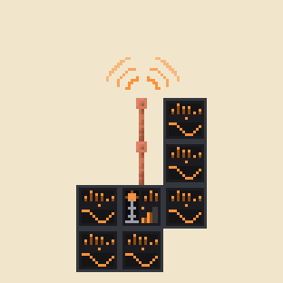

- A channel never sends alone and takes no antenna: its station goes out over the transmitter's mast, from the
  transmitter's place and with the transmitter's range.
- One transmitter sends up to 64 stations.
- A channel that is connected to no transmitter sends nothing. A switched-off transmitter switches its channels off
  with it, and a transmitter without a station of its own still sends its channels'.
- Right-click and sneak + right-click work as on the transmitter.

<br clear="right">

## Radio Amplifier

Sends every signal that reaches it on again, at full strength and with its own range. Any number of amplifiers can
follow one another.

> *"Relayed from the main transmitter."*

**Crafting** – a transmitter that re-sends:

```
I C I      I = iron ingot, C = copper ingot
C W C      W = a radio transmitter
I R I      R = redstone
```

**Use**

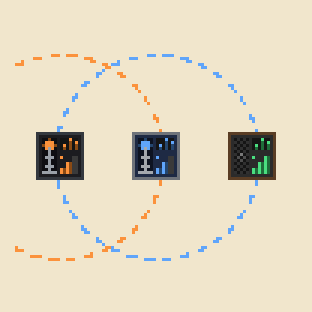

- It takes [antenna blocks](#range--antennas) like a transmitter.
- Right-click lists the signals it receives, with the transmitter's position, the distance and the hops.
- It has no switch, and it makes no sound.
- Like a transmitter it keeps working while nobody is near.

<br clear="right">

## Radio

Plays a station to everyone nearby. Its tuner lists the stations whose signal reaches this place.

> *"Good evening, dear listeners."*

**Crafting** – a wooden case with a speaker and a tuning circuit; any planks will do:

```
P I P      P = any planks, I = iron ingot
C N R      C = copper ingot (the coil), N = note block (the speaker), R = redstone (the tuner)
P P P
```

**Use**

- Right-click: the tuner. Click a station to play it; the key under the list switches the radio on or off, the slider
  is its volume.
- Sneak + right-click with an empty hand: on or off.
- It is heard for 4 blocks, and [Speakers](#speaker) carry it further. The sound falls from 100 % at the block to
  20 % at the hearing range and fades out over the next quarter of the range (at least 2 blocks).
- Silent? It plays only while it is switched on, tuned, and the signal of its station reaches it. If the signal goes
  away, it falls silent and plays again when the signal is back.

**Direction** – the sound comes from the block, like any sound in the world: turn around and it stays where the radio
is. A Portable Radio you carry plays in both ears alike.

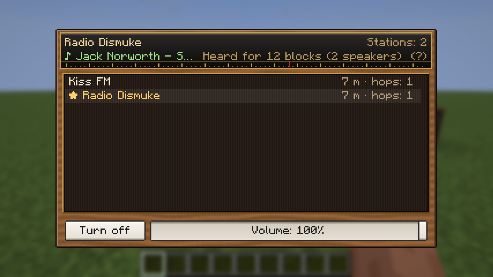

## Speaker

Makes a radio heard further and louder: every speaker adds 4 blocks, up to 64, and 5 % volume.

> *"A little louder, please!"*

**Crafting** – any planks and any wool will do:

```
P W P      P = any planks, W = any wool
P N P      N = note block
P P P
```

**Use**

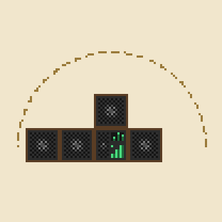

- Put it against a radio, or against a speaker that is already connected: speakers that touch the radio count, and so
  do speakers that touch one of those, and so on in a chain.
- The sound comes from the radio and from every connected speaker: next to a speaker you hear it from there. How
  loud it is still goes by the distance to the radio.
- Each speaker adds 5 points to the radio's volume of 100: with 3 speakers the slider goes up to 115 %, with all
  15 that count to 175 %.
- A connected speaker lights up while its radio plays: its ring runs outwards.
- It has no screen.

<br clear="right">

## Portable Radio

A radio to carry. It plays to you alone while it is anywhere in your inventory, as long as the signal of its station
reaches you.

> *"Music wherever you go."*

**Crafting**

```
  C        C = copper ingot (the antenna)
I N I      I = iron ingot, N = note block
  R        R = redstone
```

Switched on and tuned, the item shows green lights and its antenna; otherwise the light is red and the antenna is
pushed in. The item's tooltip shows its station.

**Use**

- Right-click: the tuner, with the stations that arrive where you stand and the volume.
- Sneak + right-click into the air: on or off.
- Of several in the inventory, the first one that is switched on and tuned plays.
- It plays at full volume inside the signal range; past the range it fades out over the next 10 blocks (a quarter of
  the range above 40).

**Putting it down** – sneak + right-click on a block puts it down. There it is a small radio that plays to everyone
within 4 blocks, with the tuner and the hearing range of the Radio block. Standing on top of a Speaker it is heard
further, and more speakers can be chained to that one; speakers beside or above it do not count. A bare hand breaks it
at once to take it along again: station, volume and on/off travel with it both ways.

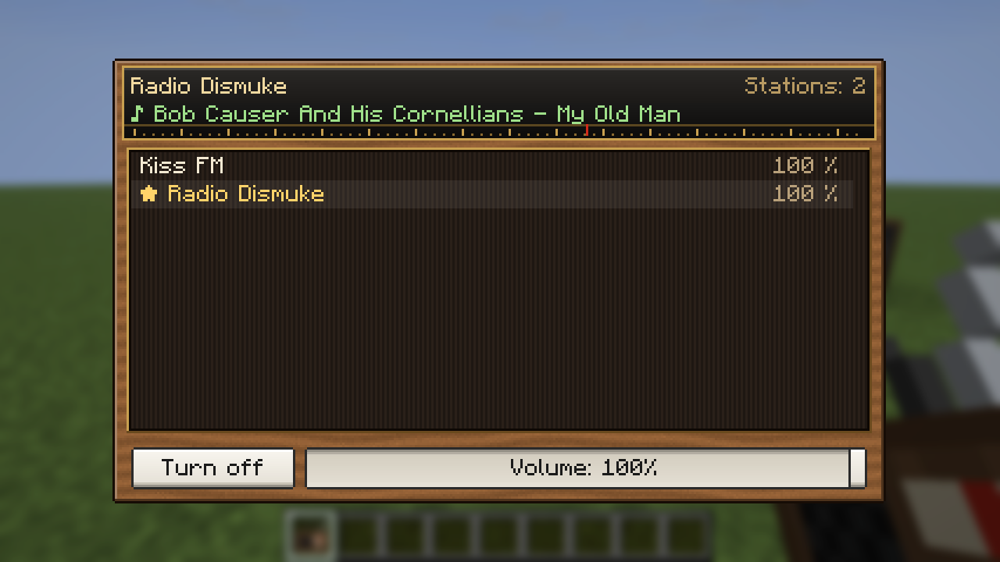

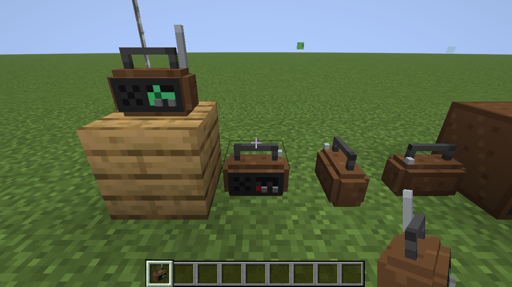

## Range & Antennas

A transmitter reaches 32 blocks. Every antenna block stacked straight on top of it adds 32 more, up to 32 antenna
blocks (1056 blocks). An amplifier counts the same way.

> *"The higher the mast, the further the music."*

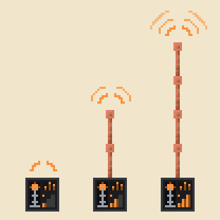

**Antenna blocks** – lightning rods, end rods, and bars and chains of iron or copper, every oxidation stage and the
waxed ones too (27 blocks). They can be mixed, and the way a block faces does not matter. They are the block tag
`worldradio:antenna`, so data packs can add more.

Click an antenna block onto the top of a transmitter or an amplifier to place it. The mast counts from the block above
up to the first block that is not an antenna block.

**Front display** – the front lights up with the mast: dark while there is nothing to send, then one bar without
antenna, two with 1 to 3 antenna blocks, and three with 4 or more. No station, switched off or no signal means a still
front and a red light; otherwise the transmitter's mast sends waves (the radio's speaker: rings) and the meter moves.
A channel has a wide meter, the light and a scope with a running wave.

<br clear="right">

The screens show the range, e.g. "Range 128 blocks (3 antenna blocks)"; the counter updates within a second of a
change anywhere in the column. Hovering the range line (or the amplifier's) explains the antenna blocks:

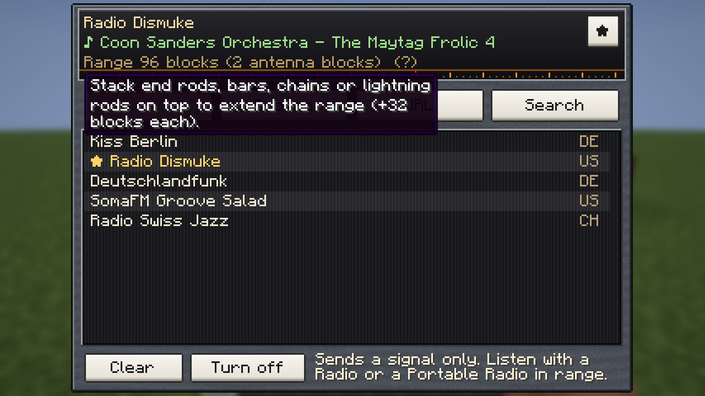

Servers may set other numbers, see [Config](#config).

## Finding Stations

The screen of a transmitter or a channel finds stations in four tabs.

> *"Don't touch that dial."*

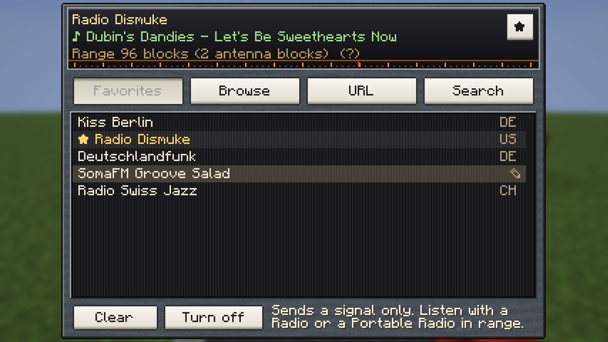

**Favorites** – your own list, which comes with you into every world and onto every server; it is kept on your
computer (`config/worldradio-favorites.json`). The star next to the station name adds or removes the station that is
tuned in; the pencil at the end of a row (it shows while the mouse is on the row) renames it: Enter keeps the new name,
Esc drops it. Worlds from before 0.5 had one list for everyone; its stations are taken over once when you join such a
world.

**Browse and Search** – Browse lists the stations of [radio-browser.info](https://www.radio-browser.info) by
country → region → station, with a filter box. Search finds them by name or genre (`jazz`, `oldies`, `80s`) and starts
when you stop typing. Name matches come first, then genre matches; within each, stations from your own country (your
Windows region, else the game language) lead, then the most listened to. Each row shows country, the first two genres
and the bitrate.

**URL** – paste any `http(s)` stream address. Playlists (`.m3u`, `.pls`) that point to a stream work too.

**Good to know** – only MP3 streams play, and only those are listed. While the screen is open, your game fetches the
station without playing it, so the line under the name tells you whether the stream works: the current song title (or
"Playing"), "Cannot play this stream" with the reason, or "No connection". **Clear** removes the station, **Turn off** /
**Turn on** stops the transmitter and keeps the station.

| Browse | URL | Search |
|---|---|---|
| 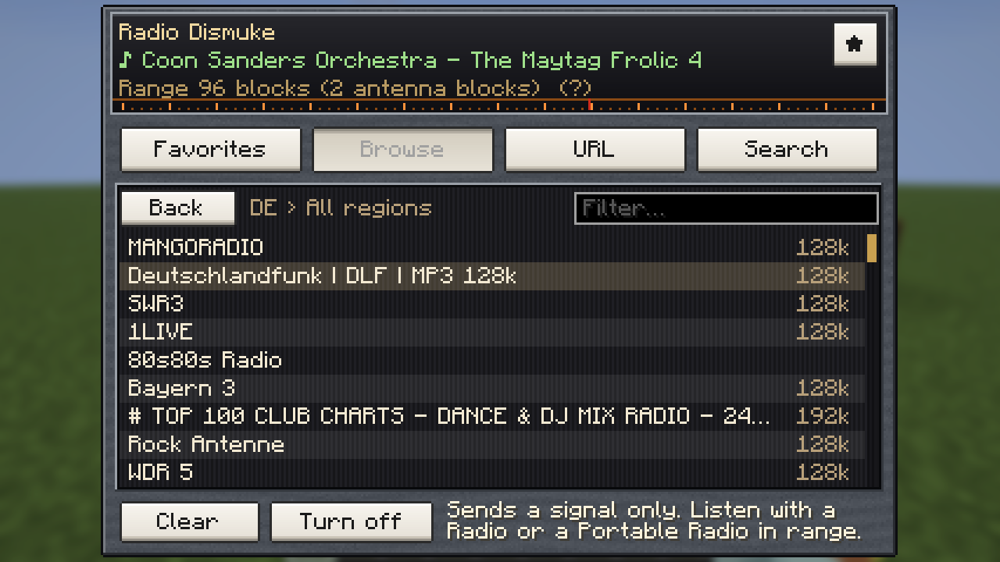 | 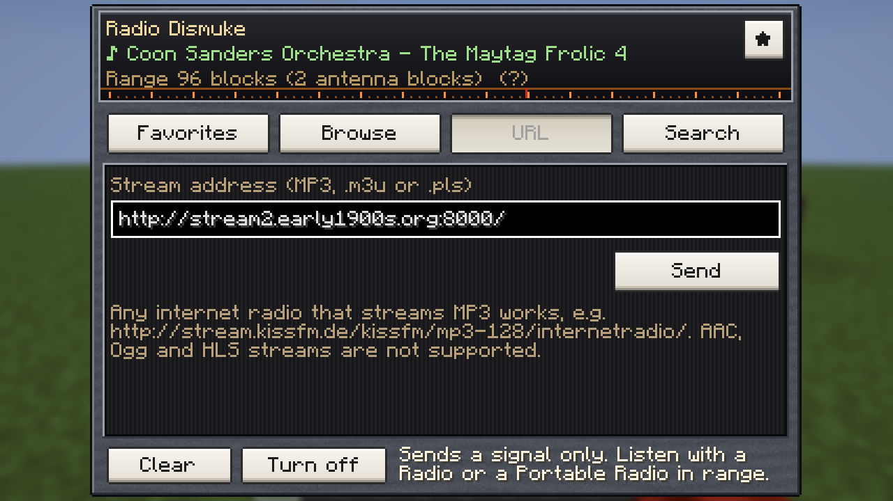 | 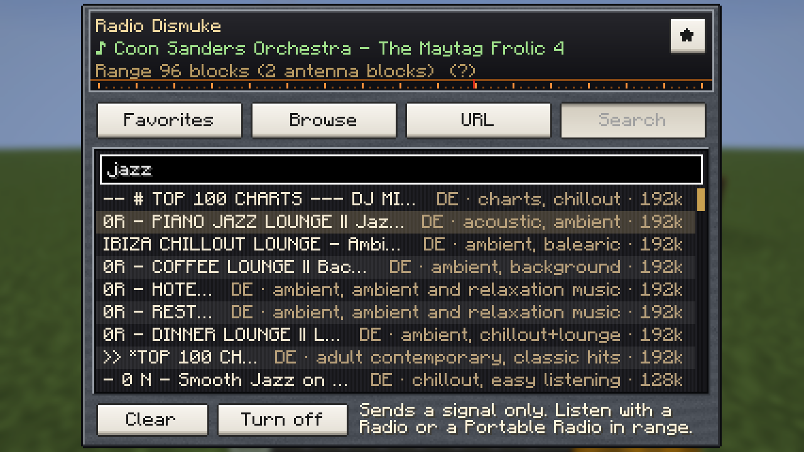 |

| Switched off | Amplifier | Creative tab |
|---|---|---|
| 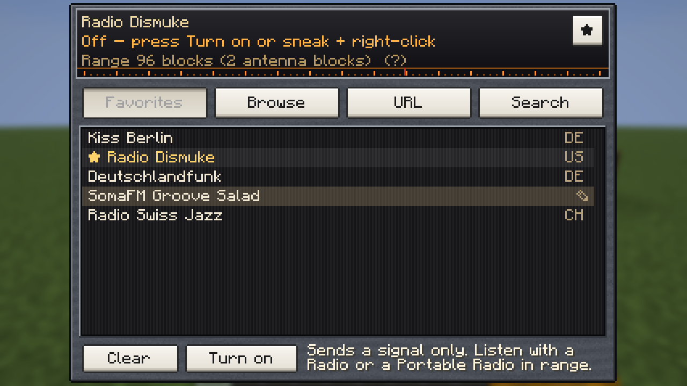 | 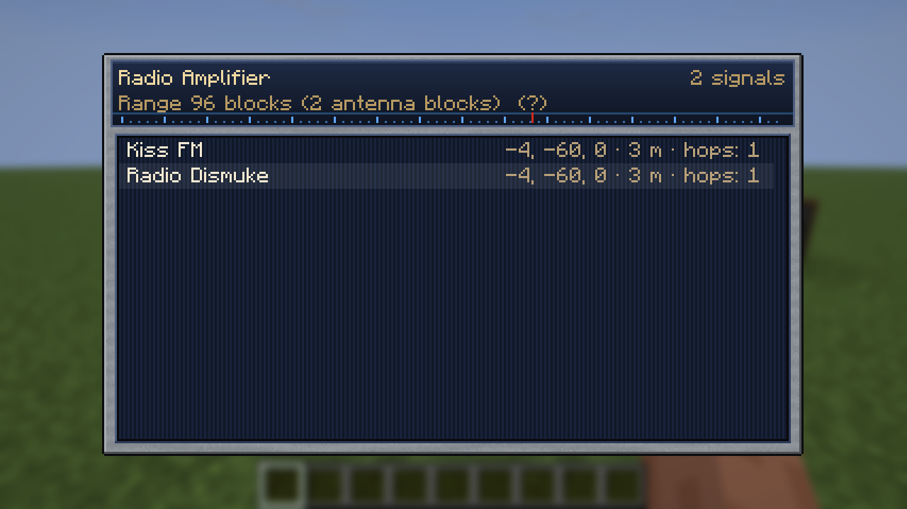 | 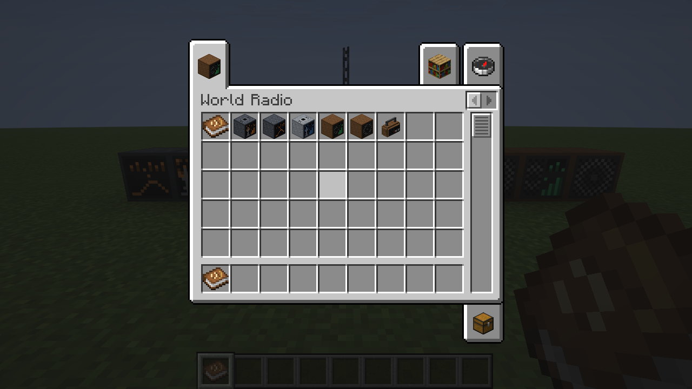 |

All screens share one design, an old radio with the station on a glass dial, cloth behind the lists and white piano
keys, in the colours of their block: dark steel and orange for the transmitter and the channel, light steel and blue
for the amplifier, teak for the radios and the guide book.

## Listening

Your own game streams the music, so it needs an internet connection. The server only passes the signal on. Players
therefore hear a station a few seconds apart.

> *"Turn it up!"*

**Volume** – every radio has its own volume slider, the same for everyone who hears it. Your own control is
*Options → Music & Sounds → Radio*.

**Several radios** – where one station is heard from several radios (or from a radio and your portable radio), only
the loudest one plays, so nothing echoes. Up to six different stations play at once.

## Limits

- MP3 only: AAC, Ogg/Opus and HLS streams show "Cannot play this stream". About 70 % of the Radio-Browser
  catalogue is MP3.
- Stereo streams are mixed down to mono, so that the game can place the sound at the radio.
- Some stations only allow known player apps and refuse the connection (SomaFM, for example).
- A speaker makes its radio heard further; the sound comes from the radio and its speakers.
- Version 2.0.0 split the Radio into transmitter and receivers. Radios from a 1.x world become Radio Transmitters
  (same block id `worldradio:radio`): station, antenna and on/off stay, their own volume is gone and they are silent
  until a Radio or Portable Radio picks them up. Amplifiers no longer make sound either.

## Config

`config/worldradio.json`:

```json
{
  "configVersion": 5,
  "baseRange": 32,
  "antennaStep": 32,
  "maxAntenna": 32,
  "hearingBase": 4,
  "speakerStep": 4,
  "hearingMax": 64,
  "speakerVolume": 5,
  "maxStations": 6
}
```

`baseRange`, `antennaStep` and `maxAntenna` (signal range), `hearingBase`, `speakerStep` and `hearingMax` (how far
a Radio block is heard: without speakers, more per speaker, and at most) and `speakerVolume` (points of volume each
speaker adds to the radio's 100) are read by the server. Older files are
carried over: the new entries are added, a `ranges` list from 0.1/0.2 is dropped, and a 0.3 file (no `configVersion`)
with the old default step of 8 is moved to 32. `maxStations` (at most 8, which is what the sound engine allows) is
read by each player's game. The numbers in the guide book and the "+32 blocks each" and "+4 blocks each" in the
tooltips come from the player's own file.

## Commands (operators)

- `/worldradio tune <pos> "<url>" [name]` – set the station of a transmitter, a channel or a radio.
- `/worldradio enable <pos> true|false` – switch a transmitter, a channel or a radio on or off.
- `/worldradio volume <pos> <0-100>` – set a radio's volume.
- `/worldradio status <pos>` – range, antenna blocks and level of a transmitter or amplifier, what a transmitter or
  channel sends, which signals an amplifier or radio receives, a radio's hearing range and speakers, what it is set
  to and whether it plays.

<!-- listing:skip -->
## Building

Java 25, `./gradlew build` → `build/libs/worldradio-<version>.jar`. Needs Fabric API on client and server, and
[bcf-guide-book-lib](https://github.com/david-stefan-hermann/bcf-guide-book-lib) in the local Maven repository first:
`./gradlew publishToMavenLocal` in a checkout of it.

Test tools in `tools/`: `test-signal.sh` (signal graph, antenna range and level, volume and reception curves, what a
portable radio picks up, source choice – plain Java), `stream-probe.sh` (decodes live streams outside
Minecraft), `dev-test-network.sh` (RCON test against the dev server), `dev-test-portable.sh` (putting a portable radio
down and taking it up again, on the dev server), `dev-screenshot.sh` (dev client screenshots, clicks with an item in
hand, using the held item, the on/off button, list clicks, renaming, the volume slider, typing, hovering, walking and
circling, and a per-second log of what the player hears), `book-shots.sh` (every page of the guide book in English and
German; checks that no translation is missing and no section is taller than a page).

The art is generated, run from the project folder: `java tools/MakeTextures.java` (block and item textures, block
models), `java tools/MakeResources.java` (blockstates, item models, loot tables),
`java tools/MakeGuiTextures.java` (screen panels and keys), `java tools/MakeBook.java` (the guide book's panel, item
texture and build pictures; preview in `art/book/`), `java tools/MakeLogo.java <variant>` (the logo `icon.png`,
rendered from the block textures; previews in `art/logo/`).

The guide book's content is data in `src/main/java/worldradio/item/GuideBook.java` (chapters of sections) with the
texts under `worldradio.book.*` in the language files; its screen comes from bcf-guide-book-lib, and the recipes on
its pages are read from the mod's own recipe files. The `docs/book-*.png` pictures on this page are the book's build
pictures on paper, three times enlarged.
<!-- listing:end -->

## Credits

- MP3 decoding: [JLayer](https://github.com/umjammer/jlayer) 1.0.1 by JavaZOOM (LGPL 2.1), bundled unmodified.
- Station catalogue: [Radio-Browser](https://www.radio-browser.info) community database.

## License

MIT, see [LICENSE](LICENSE). By BaconCakeFactory.
